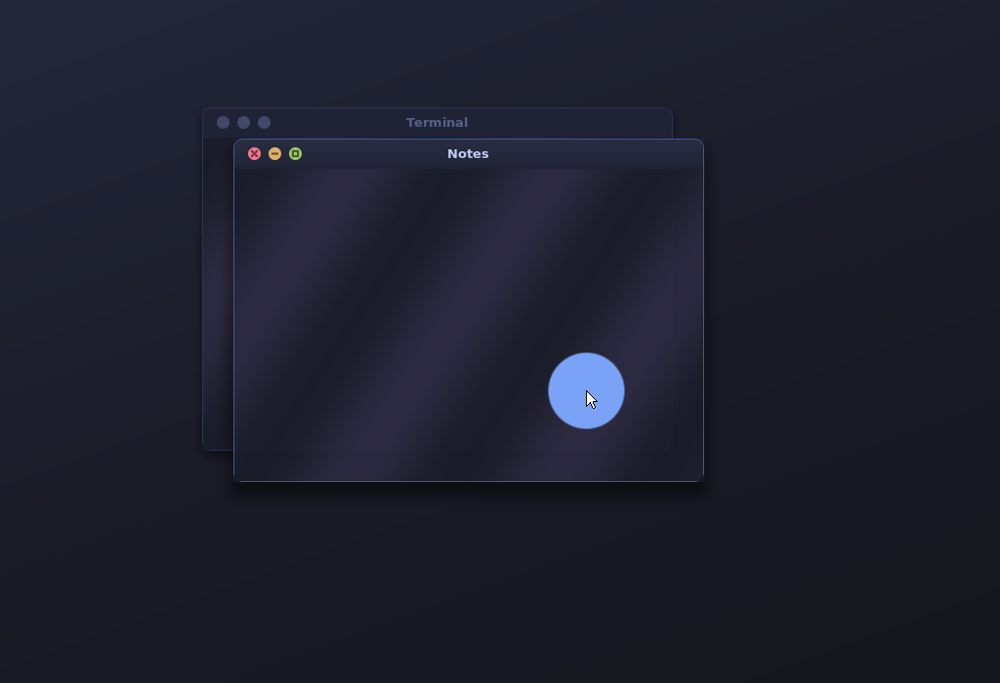
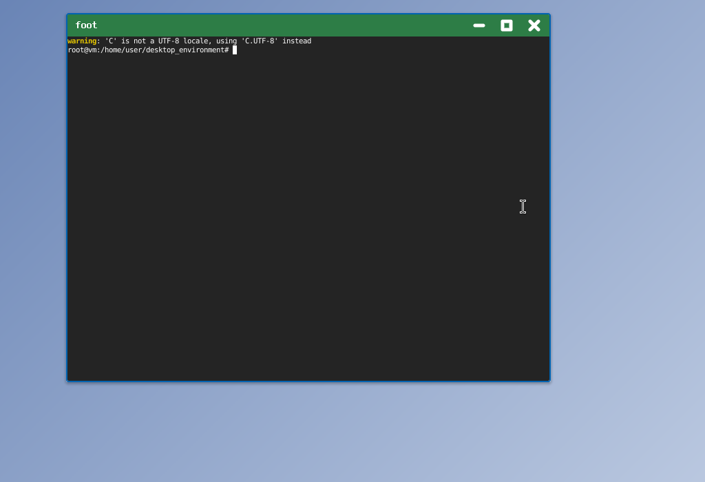

# pane

A Wayland display server and desktop written from scratch in C, without libwayland, wlroots, X11 or a GPU stack. It talks to the kernel directly (DRM/KMS for the screen, evdev for input) and speaks the Wayland protocol byte by byte. Existing applications (Qt, KDE, GTK, foot, SDL) run on it unmodified. Everything the server draws is styled with CSS.



The same server with [a different stylesheet](docs/example-light-theme.css), reloaded live:



About 8,300 lines in total. Each file starts with a comment explaining the idea it implements.

## Building

Dependencies (all available in LFS/BLFS):

| What | Why | Where |
|---|---|---|
| gcc, make, pkg-config | building | LFS |
| Linux API headers | `<drm/drm.h>`, `<linux/input.h>` | LFS chapter 5 |
| zlib | reading `.psf.gz` console fonts, writing PNG screenshots | LFS |
| libxkbcommon + xkeyboard-config | keyboard layouts; clients need the same keymap | BLFS |
| libcss, libparserutils, libwapcaplet *(optional)* | the full CSS engine (see [Theming](#theming)) | NetSurf, below |

```sh
make            # builds build/pane and build/pane-demo
make install    # optional: /usr/local/bin, theme in /usr/local/share/pane
```

The build uses libcss if `pkg-config` can find it, and the built-in CSS engine otherwise. `make CSS=builtin` or `make CSS=libcss` forces one or the other, and `make` reports which one it used.

### Building libcss

libcss and its two helper libraries come from the NetSurf browser project, at <https://download.netsurf-browser.org/libs/releases/>. They build with NetSurf's own makefile framework, which you install first. pane was tested with these versions (they need perl, which LFS has):

```sh
tar xf buildsystem-1.10.tar.gz
make -C buildsystem-1.10 PREFIX=/usr install

for lib in libwapcaplet-0.4.3 libparserutils-0.2.5 libcss-0.9.2; do
    tar xf $lib-src.tar.gz
    make -C $lib PREFIX=/usr COMPONENT_TYPE=lib-shared
    make -C $lib PREFIX=/usr COMPONENT_TYPE=lib-shared install
done
```

Kernel options:
- `CONFIG_DRM` plus the driver for your GPU (`i915`, `amdgpu`, `nouveau`, `virtio-gpu` for QEMU, or `CONFIG_DRM_SIMPLEDRM` for the firmware framebuffer)
- `CONFIG_INPUT_EVDEV`
- `CONFIG_DRM_FBDEV_EMULATION` (only for the fbdev fallback)

## Running

Log in on a text console (VT) as root, or as a user in the `video` and `input` groups, and run:

```sh
./build/pane -s ./build/pane-demo
```

The demo client depends only on xkbcommon. Move the mouse over it, click, scroll, and type: it prints each key decoded through the keymap the server sent it. Drag out of it to drag some text (with a drag icon) into another app, and drop text onto it to receive it. A white square is added for each successful drop.

| Keys | Action |
|---|---|
| **Ctrl+Alt+Backspace** | quit and return to the console |
| Alt+Tab | cycle windows (also brings back minimized ones) |
| Alt+F4 | close window |
| Super+Up / Alt+F10 | maximize / restore |
| Super+Enter / Ctrl+Alt+T | launch the terminal (`-t CMD`, default `foot`) |
| Alt+drag, Alt+right-drag | move / resize from anywhere in a window |
| right-click the title bar, or Alt+Space | the window menu: minimize, maximize, fullscreen, close, and [window classes](#window-classes) |
| Escape during a drag-and-drop | cancel the drag |
| title bar: drag, double-click, middle-click | move, maximize, minimize |

The server grabs the keyboard, so the console won't see your keys while it runs. If something goes wrong, SSH in and `kill` it; the console comes back. Crashes restore the console too. VT switching (Ctrl+Alt+F2) isn't implemented yet.

### Running real applications

Apps reach the server through `$XDG_RUNTIME_DIR/$WAYLAND_DISPLAY`. pane sets both for everything it launches. If `XDG_RUNTIME_DIR` isn't set (common on LFS without a login manager), it creates `/tmp/pane-runtime-$UID`. To start an app from another shell, copy those two variables.

Toolkits link libwayland-*client*, the library on the app side of the socket, so you'll need that from BLFS to build them. The server itself uses none of it. Tested here, with no changes to any app:

- **Qt 6 / KDE apps**: windows, server-side decorations, menus, tooltips, keyboard, clipboard, dragging text out to other apps
- **GTK 4**: draws its own (client-side) decorations; move, menus and popovers work
- **foot** (terminal; accepts dropped text), **weston-simple-shm**, and wl-copy/wl-paste (clipboard)

Apps that render with the GPU need a fallback for now, because the server only accepts shared-memory buffers. Qt Widgets and most KDE apps work as they are. For QML apps set `QT_QUICK_BACKEND=software`; for GTK 4 set `GSK_RENDERER=cairo`.

### Options

```
-b, --backend drm|fbdev|headless   (default: drm, falling back to fbdev)
-d, --device PATH                  e.g. /dev/dri/card1
-S, --size WxH                     headless screen size
-c, --theme FILE                   default: ~/.config/pane/theme.css, then ./theme.css, then built-in
-t, --terminal CMD                 for Super+Enter
-s, --startup CMD                  run once the server is up (repeatable)
```

## Theming

The theme is a CSS file. Save it and the server reloads it immediately, with no restart. The server builds a small element tree for what it draws, and a CSS engine matches selectors, applies specificity and inheritance, and computes styles, the same way a browser does:

```
desktop
window.<class>    :focused :maximized :fullscreen :hover   [app-id="..."] [title*="..."]
  titlebar
    title
    button.close / button.maximize / button.minimize   :hover :active
popup             (apps' own menus and tooltips)
menu              (the window menu)
  menuitem        :hover   .action.close (.minimize ...)   .class   .checked
  separator
  heading
cursor
```

Supported properties: `background` (colors and `linear-gradient(...)`), `color`, `border`, `border-width`, `border-color`, `border-radius` (px or %), `box-shadow`, `opacity`, `padding`, `margin`, `width`, `height`, `font-family`, `font-size`, `text-align`, `display: none`, and `float: left|right` (button placement).

Selectors and values: type, `.class`, `:state`, `[attr=v]`, `[attr*=v]`, `[attr^=v]`, `[attr$=v]`, descendant and `>` combinators; custom properties (`--accent: #7aa2f7` plus `var(--accent)`); named colors, `#rgb`, `#rrggbbaa`, `rgb()`, `rgba()`.

Fonts are Linux console PSF fonts, named as they appear in `/usr/share/consolefonts` (for example `"Lat2-Terminus16"`). `font-size` scales them by whole multiples.

```css
window[app-id="foot"] titlebar { background: #2d7d46; }   /* per-app colors */
button { float: right; }                                  /* Windows-style button side */
window:maximized { border-radius: 0; box-shadow: none; }
```

See [theme.css](theme.css) (the default) and [docs/example-light-theme.css](docs/example-light-theme.css).

### Window classes

Any window can carry CSS classes, which you toggle from its window menu (right-click the title bar, or press Alt+Space). The menu offers every class your theme styles on windows, so adding a class takes nothing more than writing CSS for it:

```css
window.work titlebar { background: linear-gradient(to bottom, #2d4a3e, #213a30); }
window.urgent { border-color: #f7768e; box-shadow: 0 0 24px rgba(247, 118, 142, 0.7); }
window.dim { opacity: 0.7; }
```

Classes combine with everything else, so selectors like `window.work:focused`, `window.dim[app-id="foot"]` and `window:not(.work)` (with libcss) all work. A window keeps its classes until it closes. Apps that draw their own title bars (GTK) also get the menu, through `xdg_toplevel.show_window_menu`, but on those windows only whole-window properties such as `opacity` have a visible effect, because pane doesn't draw their frame.

The menu itself is styled with `menu`, `menuitem`, `separator` and `heading`. A small built-in stylesheet gives it sensible defaults, so themes that don't mention it still get a usable menu. Theme rules always take priority over those defaults, the way a browser's own defaults work.

### The two CSS engines

The same theme file works with either engine; both render the default and example themes pixel-for-pixel identically.

- **libcss** (`src/css_libcss.c`) is NetSurf's engine: real CSS 2.1 parsing and the full selector syntax, so you get things like `:not()` and `[attr|=v]`. For example, `window:not(:focused) titlebar { opacity: 0.6 }` works. (pane's tree has no siblings, so sibling selectors such as `+` and `~` never match.) It implements libcss's callback interface (`css_select_handler`) over pane's element tree, and libcss calls back with questions like "what's this node's parent?" or "is it hovered?".
- **built-in** (`src/css.c`) has no dependencies and supports the selector subset listed above.

libcss doesn't support `border-radius`, `box-shadow`, gradients or `var()`, which most themes want. Before the sheet reaches libcss, `css.c` therefore rewrites it, much like a CSS preprocessor would: `var()` references are substituted, and those three values travel inside standard properties pane doesn't otherwise use (`max-width`, `content` and `background-image: url(...)`). libcss does all the matching and cascading, and pane unpacks the three values afterwards. To see exactly what libcss receives, run with `PANE_CSS_DEBUG=1`.

With libcss, a few things behave as in a browser rather than as in the built-in engine. A border needs a style to be drawn (`border: 1px solid red` rather than just `border-width: 1px`), and libcss reports its own syntax errors by silently dropping the bad declaration. pane still prints errors for the values it parses itself.

## Developing without a screen

```sh
./build/pane -b headless -S 1024x700
```

The headless backend renders into memory and takes commands on stdin, so you can script a session and take screenshots, which is how the images above were made:

```
move 400 300        rel 10 -5          click [left|right|middle]
button left down    button left up     scroll 3
key a               key alt down       key f4        key alt up
screenshot out.png  quit
```

Commands are processed as fast as they arrive, so put small pauses between a button press and the following motions when a client needs to react in between (for example GTK starting a window move).

`PANE_DEBUG=1` prints every request and event on the wire (like `WAYLAND_DEBUG=1`). `PANE_CSS_DEBUG=1` prints the stylesheet as handed to libcss.

## How it works

| File | What it does |
|---|---|
| `src/wire.c` | the wire format: 8-byte header (object id, size and opcode), 4-byte-aligned arguments, file descriptors passed with `SCM_RIGHTS` |
| `src/core.c` | clients, the per-client object table, `wl_display`, `wl_registry`, `wl_output`, protocol errors |
| `src/compositor.c` | `wl_surface` (double-buffered state, commit), `wl_region`, subsurfaces, `wl_shm` (shared-memory pixels; SIGBUS-safe copy) |
| `src/xdg.c` | windows and popups (`xdg_wm_base`), the configure/ack handshake, popup positioning, `xdg-decoration` |
| `src/seat.c` | pointer, keyboard (xkbcommon keymap shared via a sealed memfd), keybindings, clipboard, drag and drop |
| `src/wm.c` | window management: stacking, focus, hit-testing, move/resize/maximize, popup grabs, drawing |
| `src/menu.c` | the window menu: actions and toggling a window's CSS classes |
| `src/css.c` | the built-in CSS engine (tokenizer, parser, selector matcher, cascade), the value parser, and the rewrite for libcss |
| `src/css_libcss.c` | the libcss engine: the selection callbacks over pane's element tree, and turning computed styles back into pane's |
| `src/render.c`, `src/font.c` | software rasterizer (signed-distance rounded corners, gradients, shadows) and PSF fonts |
| `src/backend_drm.c` | raw KMS ioctls: connectors, CRTCs, dumb buffers, page flips (no libdrm) |
| `src/backend_fbdev.c`, `src/backend_headless.c` | the fallback and testing backends |
| `src/input.c` | evdev devices, hotplug via inotify |
| `src/main.c` | socket setup, launching apps, signals, the frame clock |
| `client/demo.c` | a complete client using the raw protocol, the counterpart to all of the above |

**The life of a frame:** a client draws into shared memory, then sends `attach`, `damage` and `commit`. On commit the server copies the damaged pixels and releases the buffer, then marks the screen dirty. Before the event loop sleeps, it draws the desktop, windows, decorations and cursor into a system-memory buffer, copies that to the hidden scanout buffer, and asks for a page flip. When the kernel reports the flip at vblank, every client that asked gets `wl_surface.frame`, which is its cue to draw the next frame.

## Status and next steps

The protocol, window management, both CSS engines and drag and drop were tested headless against Qt 6, GTK 4, foot, weston-simple-shm and wl-clipboard, with sanitizers (ASan/UBSan) enabled. The drag-and-drop tests covered demo to demo, demo to foot, Qt to demo, drops on the desktop, Escape, and the source client being killed mid-drag. **The DRM, fbdev and evdev code paths compile, but I haven't been able to run them on real hardware.** They follow the standard KMS sequence, but expect to debug on first boot. pane's startup output names the connector, mode and input devices it found, which is the place to start.

Implemented: `wl_compositor` 5, `wl_subcompositor` 1, `wl_shm` 1, `wl_output` 4, `wl_seat` 7, `wl_data_device_manager` 3 (clipboard, drag and drop), `xdg_wm_base` 3, `zxdg_decoration_manager_v1` 1.

Good next projects:
- **VT switching**: `VT_SETMODE` with `VT_PROCESS`, dropping DRM master and input grabs on release
- **Hardware cursor plane** (`DRM_IOCTL_MODE_CURSOR`), so moving the mouse doesn't redraw the screen
- **Damage tracking**: repaint only what changed
- **`linux-dmabuf`** for GPU-rendered clients, which means Mesa, GBM and EGL
- **Xwayland** for X11-only apps; it's just another Wayland client plus some window-manager glue
- The primary selection (middle-click paste), `xdg-activation`, a panel or launcher written as a client
- FreeType text, so `font-family` can name real fonts
